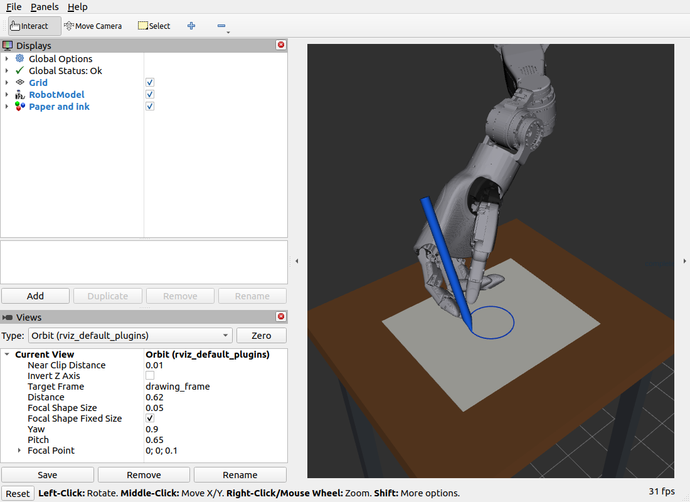

# 机械臂与灵巧手轨迹规划仿真

本仓库保存两个 ROS 2 项目，用于研究从笛卡尔末端路径到关节轨迹的计算与可视化。

| 项目 | 内容 | 主要入口 |
| --- | --- | --- |
| [chapttan5_damuzhi](chapttan5_damuzhi/) | L20 五关节拇指的指尖直线规划，解析候选逆解、数值逆解及控制器仿真 | [tip_cartesian_demo](chapttan5_damuzhi/tip_cartesian_demo/README.md) |
| [chapptan6shoubi](chapptan6shoubi/) | 七轴机械臂与 L20 灵巧手的 28 关节模型、PTP 动画、握笔姿态与笔尖画圆 | [joint_space_demo](chapptan6shoubi/joint_space_demo/README.md) |

## 环境与目录

已有验证环境为 Ubuntu 22.04、ROS 2 Humble、Python 3。根据运行内容需要 colcon、NumPy、xacro、RViz、MoveIt 2、ros2_control 和相关控制器；离线握笔网格检查另需 Pillow，旧项目绘图脚本另需 matplotlib。

两个 ROS 工作空间应分别构建、分别打开终端使用，避免包覆盖与同名 ROS 节点干扰。以下命令假设仓库克隆到 `~/jixiebi`。

```bash
cd ~
git clone https://github.com/what2004/jixiebi.git
```

## 项目一 大拇指指尖笛卡尔规划

手掌固定，通过五个拇指关节控制 `thumb_tip` 的三维位置。先预弯曲以避开零位限位，再插值直线并逐点逆解。命令行默认使用 `closed`：几何闭式候选解结合冗余参数搜索，也保留 `numeric` 和 `hybrid` 供比较。仅约束位置，指尖朝向允许变化。

不连接 ROS 的数学自检：

```bash
cd ~/jixiebi/chapttan5_damuzhi/tip_cartesian_demo
python3 tip_run.py --offline
```

构建并启动假硬件控制器仿真：

```bash
source /opt/ros/humble/setup.bash
cd ~/jixiebi/chapttan5_damuzhi/chapttan5damuzhi_ws
colcon build --symlink-install
source install/setup.bash
ros2 launch moveit_config demo.launch.py
```

另开终端加载同一工作空间后执行：

```bash
source /opt/ros/humble/setup.bash
source ~/jixiebi/chapttan5_damuzhi/chapttan5damuzhi_ws/install/setup.bash
cd ~/jixiebi/chapttan5_damuzhi/tip_cartesian_demo
python3 tip_run.py --execute --rviz
```

## 项目二 机械臂搭载灵巧手握笔画圆

机械臂根部悬挂，灵巧手位于末端。画圆时保持手指关节角和笔相对手掌的固定变换，以 `pen_tip` 的位置与朝向为目标，通过七轴机械臂的雅可比阻尼逆解生成轨迹。笔长 18 cm、直径 12 mm，笔尖以 40 层薄圆柱近似圆锥。

```bash
source /opt/ros/humble/setup.bash
cd ~/jixiebi/chapptan6shoubi/chapttan6_ws
colcon build --symlink-install
source install/setup.bash
```

画圆动画：

```bash
ROS_DOMAIN_ID=76 ros2 launch ~/jixiebi/chapptan6shoubi/joint_space_demo/circle_preview.launch.py
```

默认半径 3 cm、8 秒一圈，依次准备、落笔、画圆、抬笔并循环，笔迹随笔尖逐步出现。追加 `view:=full` 查看整条机械臂与桌子，追加 `loop:=false` 只画一次。每次启动使用独立命名空间隔离关节状态、TF 和场景。

点到点动画与握笔滑块：

```bash
ROS_DOMAIN_ID=76 ros2 launch ~/jixiebi/chapptan6shoubi/joint_space_demo/ptp_preview.launch.py
ROS_DOMAIN_ID=76 ros2 launch ~/jixiebi/chapptan6shoubi/joint_space_demo/pen_preview.launch.py gui:=true
```



## 实现范围

两个项目的上述笛卡尔算法均为自编计算。拇指项目可通过 `FollowJointTrajectory` 发送到假硬件控制器；机械臂画圆项目直接发布关节状态和 RViz Marker，用于运动可视化。桌子和纸是显示对象，笔固定连接在手掌上。目前未模拟抓取摩擦、笔尖接触力或完整的环境碰撞规划。

仓库包含源码、URDF/xacro、STL 模型、配置和代表性演示数据，构建目录、安装目录、运行日志及本地编辑器数据库均不纳入版本管理。各项目的原有作者与包信息保留。
